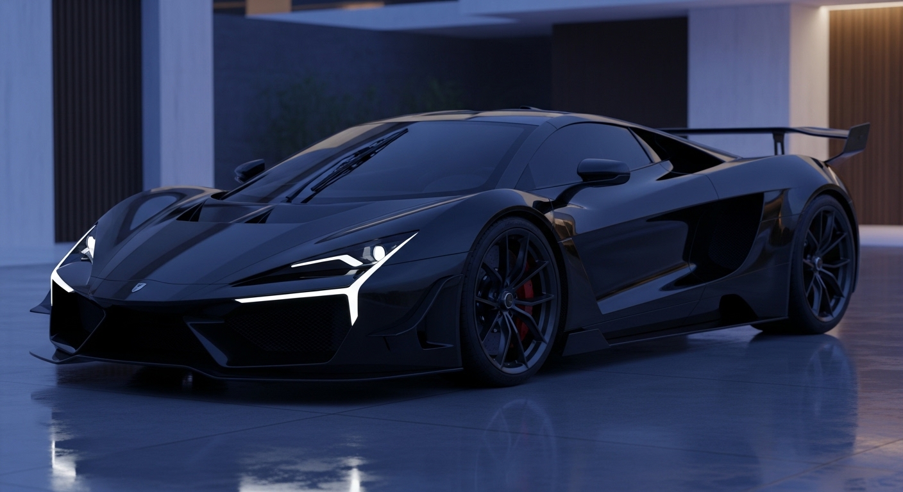

# 🏎️ ZEN GT — The Art of Mindful Driving

<p align="center">
  
</p>

<p align="center">
  <a href="https://zen-car-eta.vercel.app"></a>
  <a href="https://github.com/hackerstudent29/zen-car"></a>
</p>

<p align="center">
  
  
  
  
  
  
</p>

> *“A study in automotive minimalism, whisper acoustics, and high-performance tranquility.”*

**ZEN GT** is an ultra-premium, interactive web sanctuary for a next-generation bespoke electric hypercar. Engineered with cinematic scrollytelling, high-frame-rate canvas animation, interactive 3D HUD telemetry mechanics, an ambient meditative sanctuary, and an audio-visual full-drive immersion theater.

🔗 **Live Production Experience**: [https://zen-car-eta.vercel.app](https://zen-car-eta.vercel.app)

---

## ✨ Key Architectural Highlights

1. **🎬 120-Frame 60FPS Scrollytelling Engine**:
   - 120 high-fidelity sequential frames synchronized with scroll depth.
   - Dual-mode WebP progressive loader with graceful high-res fallback interpolation.
   - Smooth Linear Interpolation (LERP) rendering loop ensuring seamless 60 FPS frame scrubs.

2. **🧭 Floating Frosted Glassmorphism Dock**:
   - Translucent glass capsule (`backdrop-filter: blur(16px)`, `rgba(255, 255, 255, 0.16)`) featuring the glowing **`ZEN`** brand logo.
   - Pure intuitive iconography: Overview, GT Anatomy, Philosophy, and Full Cinematic Film.

3. **📊 Interactive Telemetry HUD & GT Anatomy**:
   - Real-time specifications: **0-60 mph in 2.1s**, **820 HP**, **92 kWh Solid-State Battery**, **0.20 Cd** drag coefficient.
   - Acoustic decibel monitoring (under 42 dB cabin whisper acoustics).
   - Dynamic 3D cursor tilt effects and telemetry tab state switching.

4. **🧘 Ambient Zen Sanctuary Overlay**:
   - Procedural guided meditation and breathing animation.
   - Rotating philosophical passages on tranquility, engineering, and focus.
   - Generative blooming rose SVG visualization.

5. **📱 Mobile-First Architectural Layout**:
   - **2-Column Symmetrical Grid**: Compact frosted glass cards for Navigation and Allocation.
   - **Horizontal Governance Capsule**: Seamless legal and concierge access without vertical clutter.
   - **Centered Sanctuary Brand Block**: Quick Reserve GT CTA pill and Return to Sanctuary top glide button.
   - Safe-area bottom clearance (`env(safe-area-inset-bottom)`) preventing dock overlap.

6. **🔒 Institutional Security & Privacy**:
   - Zero third-party tracker cookies.
   - Client-side form spam honeypot and interaction timestamp rate-limiting.
   - Full HSTS Preload (`max-age=63072000`), `X-Frame-Options`, `X-Content-Type-Options: nosniff`.

---

## ⚡ 20 Pre-Launch Checklist Matrix

All 20 essential production requirements are meticulously implemented:

| # | Requirement | Status | Implementation Details |
|---|---|:---:|---|
| **1** | **Privacy Policy Page** | ✅ | Dedicated [privacy.html](privacy.html) covering GDPR/CCPA, data minimization, and deletion protocols. |
| **2** | **Terms & Conditions Page** | ✅ | Dedicated [terms.html](terms.html) covering priority allocations, escrow terms, and warranty. |
| **3** | **Secrets Off Frontend** | ✅ | Zero client secret exposure. Environment abstracted via `.env.example`. |
| **4** | **Force HTTPS & Headers** | ✅ | Strict HSTS preload (`max-age=63072000`), `X-Frame-Options`, `Permissions-Policy` in [vercel.json](vercel.json). |
| **5** | **Cookie Consent Banner** | ✅ | Floating glassmorphism banner with persistent `localStorage` memory and opt-out controls. |
| **6** | **Meta Titles & Descriptions** | ✅ | Comprehensive SEO meta headers, canonical links, and OpenGraph cards across all pages. |
| **7** | **Social Preview Image** | ✅ | High-resolution branded social card `public/og-image.jpg` linked via `og:image`. |
| **8** | **Favicon & Web Manifest** | ✅ | Scalable vector crest [public/favicon.svg](public/favicon.svg) and PWA [public/site.webmanifest](public/site.webmanifest). |
| **9** | **Sitemap & robots.txt** | ✅ | Automated sitemap index [public/sitemap.xml](public/sitemap.xml) and search crawler directives in [public/robots.txt](public/robots.txt). |
| **10** | **Alt Text on All Images** | ✅ | Descriptive, contextual `alt` attributes across every diagram and media showcase. |
| **11** | **Image Optimization** | ✅ | WebP sequential frames, compressed assets, zero raw git bloat. |
| **12** | **Page Load Speed** | ✅ | Progressive 3.8s anticipation interpolation with WebP preloading and async decoders. |
| **13** | **WCAG AA Contrast** | ✅ | High-contrast gold/charcoal palette (4.5:1+ to 7:1+) with custom `:focus-visible` styling. |
| **14** | **Mobile Friendly** | ✅ | 2-column frosted glass mobile cards, clamp viewport typography, >= 44px touch targets. |
| **15** | **Custom 404 Page** | ✅ | Architectural sanctuary [404.html](404.html) with return routes to home and cinema. |
| **16** | **Zero Broken Links** | ✅ | All internal anchors (`#hero`, `#showcase`, `#philosophy`, `#performance`) verified. |
| **17** | **Form Validation** | ✅ | Client-side regex checking on name, email, phone, and region with accessible error states. |
| **18** | **Spam & Bot Mitigation** | ✅ | Invisible honeypot trap, minimum human interaction timer, and 30s cooldown limiter. |
| **19** | **Privacy Analytics** | ✅ | Custom event telemetry in [analytics.js](analytics.js) tracking pageviews, tabs, and conversions. |
| **20** | **Clear Call to Action** | ✅ | Prominent "Reserve GT" header dock, hero CTA, specs CTA, and footer reservation triggers. |

---

## 📂 Project Structure

```text
zen-car/
├── .env.example              # Environment variables template
├── .gitignore                # Production ignore rules (excludes zips, node_modules, dist)
├── 404.html                  # Custom 404 error sanctuary
├── full-video.html           # Fullscreen cinematic audio-visual drive
├── full-video.js             # Immersion video controller & angle switcher
├── index.html                # Main experience & scrollytelling canvas
├── main.js                   # Application logic, LERP scrollytelling, reservation modal
├── analytics.js              # Privacy-friendly event tracking & telemetry
├── package.json              # NPM scripts and build configuration
├── privacy.html              # GDPR/CCPA Privacy Policy
├── style.css                 # Design system, glassmorphism, responsive architecture
├── terms.html                # Terms & Conditions
├── vercel.json               # Vercel deployment settings & HSTS security headers
├── vite.config.js            # Multi-page Vite production rollup configuration
├── LICENSE                   # MIT License
│
├── public/                   # Static production assets
│   ├── favicon.svg           # Scalable vector favicon
│   ├── site.webmanifest      # PWA application manifest
│   ├── robots.txt            # Search engine directives
│   ├── sitemap.xml           # XML sitemap for SEO
│   ├── og-image.jpg          # Social preview share card
│   ├── opening_shot_frames/  # 120-frame sequential animation frames
│   ├── full_video/           # Extended video sequence frames
│   └── antigravity images/   # Production-copied video & image assets
│
└── fonts/                    # High-fidelity web typography (Chillax, Satoshi, Rosaline)
```

---

## 🛠️ Local Development

### 1. Prerequisites
- **Node.js**: v18.0.0 or higher
- **npm** or **pnpm** / **yarn**

### 2. Installation
```bash
# Clone the repository
git clone https://github.com/hackerstudent29/zen-car.git

# Navigate into the project
cd zen-car

# Install dependencies
npm install
```

### 3. Launch Development Server
```bash
npm run dev
```
Open [http://localhost:5173](http://localhost:5173) in your browser.

---

## 🚀 Building for Production

```bash
npm run build
```
Generates an optimized, tree-shaken, and minified production build in the `dist/` directory including all 5 HTML entry points:
- `dist/index.html`
- `dist/full-video.html`
- `dist/privacy.html`
- `dist/terms.html`
- `dist/404.html`

Preview the build locally:
```bash
npm run preview
```

---

## ☁️ Deployment

This repository is optimized for one-click deployment on **Vercel**:
- **Framework Preset**: Vite
- **Build Command**: `npm run build`
- **Output Directory**: `dist`

Live production instance: **[zen-car-eta.vercel.app](https://zen-car-eta.vercel.app)**

---

## 📄 License

Distributed under the **MIT License**. See [LICENSE](LICENSE) for details.

Crafted with tranquility by **[hackerstudent29](https://github.com/hackerstudent29)** for **ZEN Automotive Corporation**.
